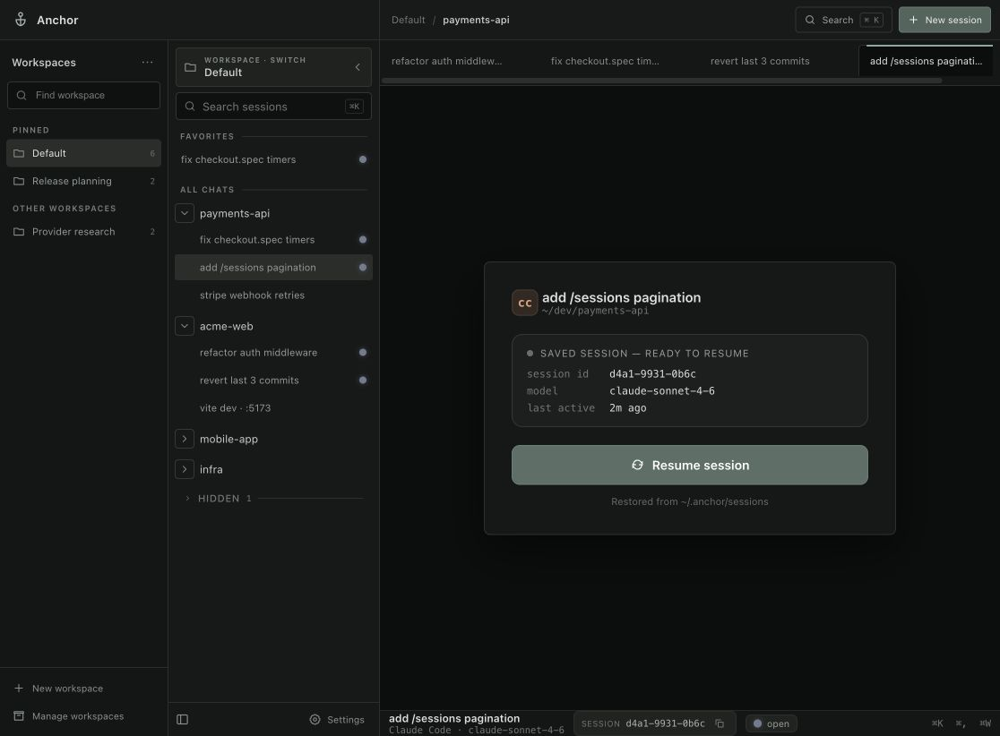

# Anchor

**All your AI coding sessions in one place.**

Run your coding assistants side by side, keep work grouped by project, and
return to saved conversations after a restart.

*Current app interface with sample projects and simulated sessions.*

[Download Anchor](https://github.com/moorej2400/anchor/releases/latest) ·
[Getting started](docs/getting-started.md) ·
[Settings guide](docs/configuration.md)

## Keep your work together

- **Your tools, one window.** Use Claude Code, Codex, GitHub Copilot CLI,
  OpenCode, or a regular terminal without switching apps.
- **Pick up where you left off.** Reopen saved AI conversations with their
  original session IDs. Restore saved output for regular terminals.
- **Less clutter.** Group chats by project, use separate workspaces, and pin
  favorites for quick access.
- **See what needs attention.** Unread response indicators help you track
  several sessions at once. Optional notifications bring you back when needed.
- **Find work fast.** Search sessions and switch between them from the keyboard.
- **Make it yours.** Choose dark themes, terminal colors, text size, and your
  own command-line tools.

## Get started

1. [Download the app](https://github.com/moorej2400/anchor/releases/latest)
   for macOS, Windows, or Linux.
2. Install and sign in to the coding assistant you want to use. If you already
   use it in your terminal, you can use that setup in Anchor.
3. Open Anchor, choose **New session**, select a project folder, and pick a tool.

Anchor runs the tools installed on your computer. Each tool uses its own
account or provider setup.

See the [getting started guide](docs/getting-started.md) for installation help
and your first session.

## Learn more

- [Settings and custom tools](docs/configuration.md)
- [Development and the full app preview](docs/development.md)
- [Building releases](docs/releases.md)
- [Product and technical specification](docs/SPEC.md)
